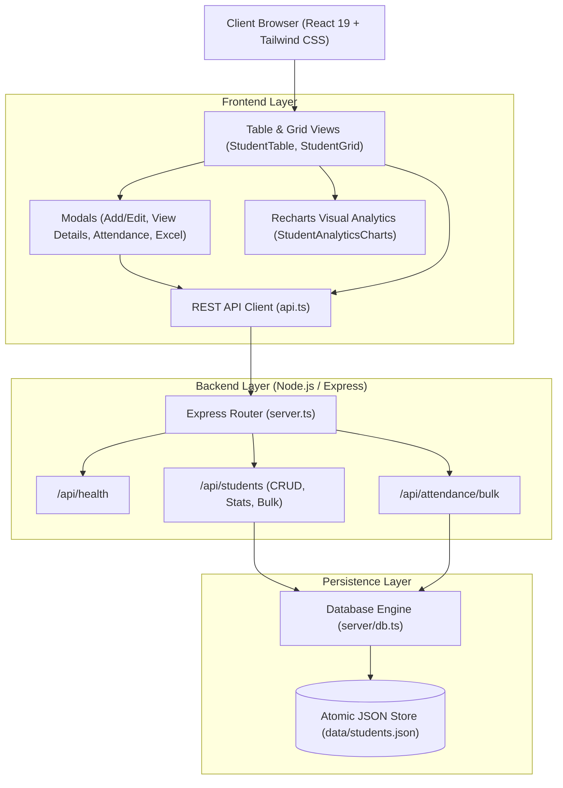

<div align="center">

# 🎓 Student Management System (SMS)
### *Enterprise-Grade Academic Records & Registry Platform*

[](https://react.dev/)
[](https://www.typescriptlang.org/)
[](https://nodejs.org/)
[](https://expressjs.com/)
[](https://tailwindcss.com/)
[](https://vitejs.dev/)
[](#testing--quality-assurance)
[](LICENSE)

<br />

> **A robust, full-stack student information system designed for academic institutions, universities, and departmental registries.**
> Featuring atomic JSON database persistence, high-performance REST APIs, real-time Recharts performance analytics, automated Excel workbook import/export, and certified PDF academic transcripts.

[Explore Features](#-key-features) • [Implementation Milestones](#-project-implementation-milestones) • [REST API Reference](#-rest-api-specification) • [Quick Start](#-quick-start)

</div>

---

## 📑 Table of Contents

- [Overview](#-overview)
- [Project Implementation Milestones](#-project-implementation-milestones)
  - [Step 1: Frontend Interface Design](#step-1-design-the-frontend-interface)
  - [Step 2: Backend REST APIs](#step-2-create-backend-apis)
  - [Step 3: Database Connectivity](#step-3-implement-database-connectivity)
  - [Step 4: Full CRUD Operations](#step-4-add-crud-operations)
  - [Step 5: Testing & QA](#step-5-test-application-functionality)
- [Key Features Showcase](#-key-features)
  - [1. Add Students](#1-add-students)
  - [2. View Student Details](#2-view-student-details)
  - [3. Update Records](#3-update-records)
  - [4. Delete Records](#4-delete-records)
  - [5. Daily Attendance Logger](#5-daily-attendance-logger)
  - [6. Excel Bulk Automation](#6-excel-bulk-automation)
- [System Architecture](#-system-architecture)
- [REST API Specification](#-rest-api-specification)
- [Project Structure](#-project-structure)
- [Quick Start & Setup](#-quick-start)
- [Testing & Quality Assurance](#-testing--quality-assurance)

---

## 🌟 Overview

The **Student Management System** provides an end-to-end digital registry for tracking student enrollment, academic metrics, and administrative workflows. Built with modern web standards, it eliminates manual paperwork by delivering:

- ⚡ **Dual View Layouts:** Toggle between a high-density tabular view and an interactive profile card grid.
- 📊 **Recharts Data Intelligence:** Visual GPA distribution histograms and cohort-level performance tracking.
- 📜 **Certified Transcripts:** Instant client-side generation of tamper-evident academic PDF transcripts with university seal.
- 📂 **Spreadsheet Compatibility:** Automated two-way synchronization with Excel (`.xlsx`, `.xls`) and CSV files.
- 🌍 **Global Phone Handling:** Integrated calling codes for every sovereign nation (~200 countries) with strict numeric input validation.

---

## 🎯 Project Implementation Milestones

This application has been developed strictly according to the five core project milestones:

### **Step 1: Design the Frontend Interface**
- **Editorial Typography & Visual Hierarchy:** Styled using a modern palette with Google Fonts (*Cormorant Garamond* serif for editorial elegance, *Geist* and *Geist Mono* for crisp data tables).
- **Dual Display Modes:** Instant toggle between a dense **Table View** ([StudentTable.tsx](src/components/StudentTable.tsx)) and an interactive **Profile Card Grid** ([StudentGrid.tsx](src/components/StudentGrid.tsx)).
- **Real-Time Search & Highlighting:** Case-insensitive search matching roll numbers, names, departments, and emails with inline keyword highlight chips ([HighlightText.tsx](src/components/HighlightText.tsx)).
- **Multi-Attribute Filters:** Filter by academic department, active status, academic year, and sort dynamically by GPA, attendance, name, or roll number ([StudentFilters.tsx](src/components/StudentFilters.tsx)).
- **KPI Dashboards:** Real-time summary statistics cards showcasing total enrollment, active scholars, average cohort GPA, and honors students ([StatsCards.tsx](src/components/StatsCards.tsx)).

### **Step 2: Create Backend APIs**
- **Express HTTP Engine:** High-performance REST server initialized in [server.ts](server.ts) with JSON body parsers, route handlers, and error interception.
- **RESTful Endpoints:** Standardized routing for cohort diagnostics, individual student lookups, CRUD lifecycles, attendance logging, and bulk spreadsheet ingestion.
- **Interactive API Explorer:** An integrated in-app REST client ([ApiExplorerModal.tsx](src/components/ApiExplorerModal.tsx)) enabling administrators and developers to test all live endpoints with one click.

### **Step 3: Implement Database Connectivity**
- **Persistent Atomic Storage:** High-reliability JSON database implementation in [server/db.ts](server/db.ts) writing directly to `data/students.json`.
- **Connection Health Checks:** Dedicated `GET /api/health` diagnostic endpoint returning database connection status, service name, and server timestamps.
- **Cold-Start Auto-Seeding:** Automatically populates a sample dataset of university students on first boot if no database file is present.
- **Data Integrity Constraints:** Guaranteed uniqueness on student roll numbers, schema sanitization, and atomic transactional writes.

### **Step 4: Add CRUD Operations**
- **Create (Add):** Full modal form with required field validation, world country calling code selector, and numbers-only phone input.
- **Read (View):** Real-time filtered grid/table listing, detailed modal inspection, and PDF academic transcript export.
- **Update (Edit):** Form prefilled with existing student data, automatic phone string dissection, and academic record updates.
- **Delete (Remove):** Safe deletion workflow with verification dialog to prevent unintentional data removal.

### **Step 5: Test Application Functionality**
- **Automated Unit Testing:** 20 test suites running natively via Node.js test runner covering:
  - Business logic, GPA formatting, and academic standing calculation ([studentLogic.test.ts](src/utils/studentLogic.test.ts)).
  - Fuzzy Excel column normalization, empty row handling, and 10-point GPA scaling ([excelLogic.test.ts](src/utils/excelLogic.test.ts)).
  - World country dialing code resolution and phone digit extraction ([countryCodes.test.ts](src/utils/countryCodes.test.ts)).
- **Static Typing & Linting:** Strict TypeScript checks (`tsc --noEmit`) passing with **0 warnings and 0 errors**.
- **Production Build:** Optimized production build with bundle minimization verified via `npm run build`.

---

## 🚀 Key Features

```
┌────────────────────────────────────────────────────────────────────────┐
│                        STUDENT MANAGEMENT SYSTEM                       │
├─────────────────┬───────────────────┬──────────────────┬───────────────┤
│  ADD STUDENTS   │  UPDATE RECORDS   │  DELETE RECORDS  │ VIEW DETAILS  │
│ Country Code +  │ Prefilled Data +  │ Safety Dialog +  │ Academic PDF  │
│ Digits-Only Tel │ In-place Update   │ Permanent Sync   │ Transcript    │
└─────────────────┴───────────────────┴──────────────────┴───────────────┘
```

### 1. Add Students
- **Component:** [StudentFormModal.tsx](src/components/StudentFormModal.tsx)
- **API Endpoint:** `POST /api/students`
- **Feature Highlights:**
  - **Comprehensive Country Code Directory:** Features every country and territory in the world (~200 countries) alphabetically sorted with national flag emojis and dialing codes (e.g. 🇺🇸 `+1`, 🇮🇳 `+91`, 🇬🇧 `+44`, 🇦🇪 `+971`, 🇩🇪 `+49`, 🇯🇵 `+81`).
  - **Strict Numbers-Only Guard:** Prevents non-numeric characters on keypress; clipboard paste sanitization strips letters and symbols automatically.
  - **Schema Validation:** Instant visual feedback for missing required fields, email format validation, and duplicate roll number protection.

### 2. View Student Details
- **Component:** [StudentDetailModal.tsx](src/components/StudentDetailModal.tsx)
- **API Endpoint:** `GET /api/students/:id`
- **Feature Highlights:**
  - **Comprehensive Profile:** Detailed view of student information, academic standing honors badge (*Summa Cum Laude / Dean's List*), enrolled courses, and emergency contacts.
  - **Certified Academic Transcript:** Branded PDF generator via `jsPDF` providing an official, printable transcript complete with course credits, grades, GPA calculations, and registrar verification seal ([pdfService.ts](src/services/pdfService.ts)).
  - **Attendance History Log:** Visual progress bar and historical roll call log entries.

### 3. Update Records
- **Component:** [StudentFormModal.tsx](src/components/StudentFormModal.tsx) *(Edit Mode)*
- **API Endpoint:** `PUT /api/students/:id`
- **Feature Highlights:**
  - **Smart Phone Dissection:** [parsePhoneNumberWithCountry](src/utils/countryCodes.ts) automatically separates stored phone strings into the correct country code and local number digits.
  - **Dynamic In-Place Updates:** Modify GPA, semester, address, emergency contact, enrollment status, or remarks with instant UI and database synchronization.

### 4. Delete Records
- **Component:** [DeleteConfirmModal.tsx](src/components/DeleteConfirmModal.tsx)
- **API Endpoint:** `DELETE /api/students/:id`
- **Feature Highlights:**
  - **Safe Deletion Guard:** Requires explicit user confirmation displaying student name, roll number, and department.
  - **Immediate Sync:** Automatically removes the record from persistent storage and updates cohort KPIs instantly.

### 5. Daily Attendance Logger
- **Component:** [AttendanceLoggerModal.tsx](src/components/AttendanceLoggerModal.tsx)
- **API Endpoints:** `POST /api/students/:id/attendance` & `POST /api/attendance/bulk`
- **Feature Highlights:**
  - Record individual or batch roll calls (*Present, Absent, Late, Excused*).
  - Quick action buttons: **Mark All Present**, **Mark All Absent**.
  - Dynamic attendance percentage recalculation stored directly on student records.

### 6. Excel Bulk Automation
- **Bulk Import Modal:** [ExcelImportModal.tsx](src/components/ExcelImportModal.tsx)
- **Excel Service:** [excelService.ts](src/services/excelService.ts) & [excelLogic.ts](src/utils/excelLogic.ts)
- **Feature Highlights:**
  - **Fuzzy Header Matcher:** Accepts any variation of column headers (`Roll Number`, `Roll No`, `Student ID`, `GPA (4.0 Scale)`, `Attendance (%)`).
  - **Auto-Normalization:** Automatically normalizes 10-point GPA scales and percentage attendance strings (`95%` or `0.95`).
  - **Blank Row Skipping:** Ignores empty trailing spreadsheet rows silently.
  - **Multi-Sheet Export:** Generates an official 3-sheet `.xlsx` workbook (*Students, Cohort Analytics Summary, Department Breakdown*) with styled column widths.

---

## 🏗️ System Architecture



---

## 📡 REST API Specification

All endpoints communicate via standard JSON with consistent `{ success, data, error }` envelopes:

| Method | Endpoint | Description | Request / Query | Status |
|:---:|---|---|---|:---:|
| `GET` | `/api/health` | Service health status and database connectivity check | *None* | `200` |
| `GET` | `/api/students/stats` | Aggregate cohort metrics (total, active, average GPA, honors) | *None* | `200` |
| `GET` | `/api/students` | List all students with filtering, search, and sorting | `?search=&department=&status=&sortBy=&sortOrder=` | `200` |
| `GET` | `/api/students/:id` | Fetch full record details and transcripts for a student | `:id` (e.g. `std_01`) | `200` / `404` |
| `POST` | `/api/students` | **Add Student:** Register a new student record | JSON Student Body | `201` / `400` |
| `PUT` | `/api/students/:id` | **Update Record:** Modify student details and metrics | Partial Student JSON | `200` / `400` |
| `DELETE` | `/api/students/:id` | **Delete Record:** Remove student from registry | `:id` | `200` / `404` |
| `POST` | `/api/students/bulk` | Ingest and upsert batch students from spreadsheets | `{ students: [...] }` | `200` / `400` |
| `POST` | `/api/students/:id/attendance` | Record individual student attendance entry | `{ date, status, notes }` | `200` / `400` |
| `POST` | `/api/attendance/bulk` | Record batch daily attendance for a specific date | `{ date, records: [...] }` | `200` / `400` |
| `POST` | `/api/students/reset` | Restore database to initial demonstration dataset | *None* | `200` |

---

## 📁 Project Structure

```text
student-management-system/
├── data/
│   └── students.json                  # Persistent atomic JSON database
├── server/
│   └── db.ts                          # Database controller, constraints & seeding
├── src/
│   ├── components/
│   │   ├── ApiExplorerModal.tsx       # Live REST API interactive tester
│   │   ├── AttendanceLoggerModal.tsx  # Daily attendance roll call modal
│   │   ├── DeleteConfirmModal.tsx     # Safe deletion confirmation modal
│   │   ├── ExcelImportModal.tsx       # Spreadsheet upload & preview modal
│   │   ├── Header.tsx                 # Top navigation, view toggle, actions
│   │   ├── HighlightText.tsx          # Real-time search query highlighting
│   │   ├── LoginPage.tsx              # Institutional SSO & portal access
│   │   ├── NotificationToast.tsx      # System alert toasts
│   │   ├── StatsCards.tsx             # Cohort KPIs & metrics summary
│   │   ├── StudentAnalyticsCharts.tsx # Recharts GPA & cohort graphs
│   │   ├── StudentDetailModal.tsx     # Full profile & transcript viewer
│   │   ├── StudentFilters.tsx         # Search, department, year & sort controls
│   │   ├── StudentFormModal.tsx       # Add / Edit form with country codes
│   │   ├── StudentGrid.tsx            # Visual profile cards grid view
│   │   └── StudentTable.tsx           # Dense tabular records view
│   ├── services/
│   │   ├── api.ts                     # Frontend HTTP service
│   │   ├── excelService.ts            # Excel parsing & multi-sheet export
│   │   └── pdfService.ts              # Certified PDF transcript generation
│   ├── types/
│   │   └── student.ts                 # TypeScript interfaces & DTO schemas
│   ├── utils/
│   │   ├── countryCodes.ts            # World calling codes (~200 countries) & parsing
│   │   ├── countryCodes.test.ts       # Calling code test suite
│   │   ├── excelLogic.ts              # Column normalization & GPA conversion
│   │   ├── excelLogic.test.ts         # Excel parser test suite
│   │   ├── studentLogic.ts            # Validation, GPA & stats algorithms
│   │   └── studentLogic.test.ts       # Student logic test suite
│   ├── App.tsx                        # Main application orchestrator
│   ├── index.css                      # Tailwind design system tokens
│   └── main.tsx                       # React DOM entry point
├── .env.example                       # Environment configuration template
├── .gitignore                         # Strict exclusion rules
├── package.json                       # Scripts and project dependencies
├── README.md                          # Project documentation
├── server.ts                          # Express server & Vite integration
├── tsconfig.json                      # Strict TypeScript compiler options
└── vite.config.ts                     # Vite build & bundler configuration
```

---

## ⚡ Quick Start

### Prerequisites
- [Node.js](https://nodejs.org/) (v18.0.0 or higher recommended)
- `npm` (v9+)

### 1. Installation
Clone the repository and install the dependencies:
```bash
git clone https://github.com/Aditya1791/Student-FORM.git
cd Student-FORM
npm install
```

### 2. Environment Configuration (Optional)
```bash
cp .env.example .env
```

### 3. Launch the Application
Run the integrated development server (starts both Express REST API and Vite frontend):
```bash
npm run dev
```

The system will start and be accessible at:
- 🌐 **Web Interface:** [http://localhost:3000](http://localhost:3000)
- 🩺 **Health Check API:** [http://localhost:3000/api/health](http://localhost:3000/api/health)
- 👥 **Students REST API:** [http://localhost:3000/api/students](http://localhost:3000/api/students)

---

## 🧪 Testing & Quality Assurance

The application features **20 automated unit tests** verifying core logic, data parsing, and phone numbers:

```bash
# Run all unit test suites
npm test
```

### Output:
```text
✔ calculateAcademicStanding assigns correct honors and warnings
✔ formatGpa handles numbers and edge cases
✔ validateStudentPayload catches missing required fields and format issues
✔ filterStudents searches by name, roll number, department, and status
✔ computeStudentStats computes aggregates correctly
✔ computeGpaDistribution distributes students into correct brackets
✔ computeCohortTrends calculates averages per year
✔ getHighlightedParts splits and matches text case-insensitively
✔ calculateAttendancePercentage calculates accurate percentage scores
✔ getAttendanceColor assigns appropriate severity color classes
✔ normalizeStudentRow correctly parses standard column names
✔ normalizeStudentRow parses headers with spaces and special symbols
✔ normalizeStudentRow accepts alternate roll number variations
✔ normalizeStudentRow splits full name when first/last not separated
✔ normalizeStudentRow handles empty rows gracefully
✔ normalizeStudentRow converts 10-point GPA scale and percentage attendance
✔ normalizeStudentRow reports validation errors for invalid rows
✔ ALL_COUNTRY_CODES contains all major world countries and territories
✔ SORTED_COUNTRY_CODES is sorted alphabetically by name
✔ parsePhoneNumberWithCountry correctly extracts dialCode and numeric digits

ℹ tests 20 | pass 20 | fail 0
```

### Additional Quality Commands:
```bash
# Type check without emitting files
npm run lint

# Compile production-ready bundle
npm run build

# Start production server
npm start
```

---

## 📄 License

This project is licensed under the [MIT License](LICENSE).
Feel free to use and adapt it for academic, personal, or commercial evaluation.
